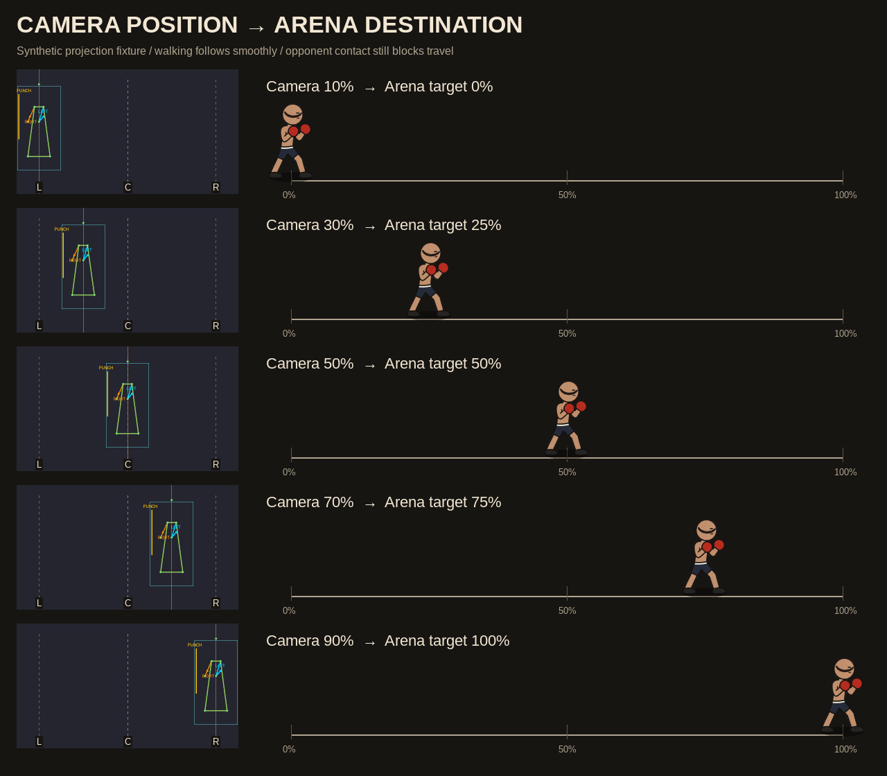
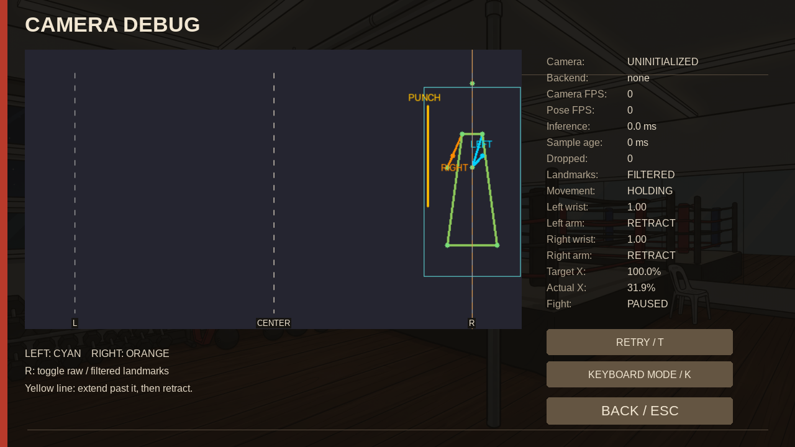

# Camera position matches arena position

Implemented on `drive-assets-update`, against baseline `a1df965`, and verified
November 5, 2026 (Asia/Manila). `main`, the seven maps, fighter identities, body
size, punch detection, and opponent collision blocking remain unchanged.

## Behavior

The previous controller added hip displacement to a movable resting anchor and
clamped the result to 5–65% of the arena. The new controller uses:

```python
display_x = 1 - raw_hip_center_x if mirror_input else raw_hip_center_x
target = clamp((display_x - 0.10) / 0.80, 0.0, 1.0)
world_x = arena_left + target * (arena_right - arena_left)
```

The legal fighter-center bounds are currently x=144 and x=1136, accounting for
walls and the 108-pixel body width. Camera positions 10%, 30%, 50%, 70%, and 90%
map to arena destinations 0%, 25%, 50%, 75%, and 100%. Reaching either guide
reaches that target before a hip must leave the image.

Stopping changes only the local jitter dead zone. It cannot shift the absolute
mapping. R, tracking loss, and mirror changes freeze movement for stable
reacquisition; the boxer then follows the corresponding absolute target with
normal bounded walking, rather than retaining a new positional offset.
Initial camera acquisition can therefore walk the boxer from the fight's spawn
toward the camera-aligned destination.

**Movement Response** retains the existing saved `sensitivity` value but changes
following response and acceleration only. `TrackingData.movement_response`
defaults to 1.0. Position mapping and maximum speed are independent of this
setting; keyboard movement retains its original behavior.

All four camera views use the same mirror projection. Video is oriented first,
then labels/geometry are drawn in display coordinates. Raw inference coordinates,
anatomical landmark IDs, left/right punch events, and charge detection are not
mirrored or swapped. L/C/R labels are added after resizing, keeping the small
in-game inset readable. Mirror changes invalidate cached previews; crossed-wrist
labels use separate vertical positions.

The opponent still blocks passage. A target at 100% is valid even when contact
prevents the boxer from reaching it. The destination is retained and following
continues when space opens. F3 shows target and actual position during play;
Camera Debug also shows both, and explicitly marks a paused fight.





These are synthetic diagnostic images, not screenshots of live tracking.

## Tests

The full suite now passes **140 tests**. New checks cover the five mapping points
and both mirror modes, edge clamping, far-right destinations beyond the old 65%
cap, repeated stops/reversals, response-independent destinations, response-bounded
speed, mirror changes, R, stable reacquisition without teleporting, legal arena
endpoints, collision blocking and subsequent following, and response propagation
through `Game`.

Preview checks cover all four screens, cache invalidation/reuse, mirrored pixels,
projected boundaries, unchanged anatomical events/landmarks, and crossed-arm label
placement. Existing jitter, size, stale/duplicate samples, fast arm filtering,
charge/readiness, recovery, navigation, saved settings, and delayed-camera tests
continue to pass. The stationary-jitter fixture now starts at the absolute center
instead of the former calibration-relative 35% position.

## Supplied recording replay

The new recording contains a 26.467-second video stream, sampled at 30 Hz
(**794 samples**). Its camera inset is at `64,426,396,222`, not the earlier
recording's ROI. A static header template locates the inset within ±40 pixels
because hit shake moves the entire canvas: **32 samples** needed that correction.
The final result screen has no camera inset and is excluded from inference.

| Replay classification | Samples | Seconds |
|---|---:|---:|
| Valid, unblocked in the collision fixture | 2 | 0.067 |
| Valid, blocked in the collision fixture | 0 | 0 |
| Missing/unreliable hips or pose | 626 | 20.867 |
| Stable reacquisition not yet complete | 33 | 1.100 |
| Result screen without camera inset | 133 | 4.433 |

These classifications come from rerunning inference on the recording; they are
not a reconstruction of the original game's internal tracking statuses. The small
inset has already been downscaled and includes baked skeleton lines, making hip
tracking substantially less reliable than raw webcam frames. Pose presence alone
is insufficient: both hips must meet the retained confidence threshold.

Both baseline and updated targets were evaluated on the same recovered poses.
Only two samples survived confidence/reacquisition checks. On those samples,
mean target difference from the filtered hip's absolute projection was 0.12460
before and 0.00163 after (normalized arena width). **Two samples cannot establish
live alignment accuracy or a representative improvement percentage.** The replay
did not exercise the full horizontal range; synthetic tests provide that coverage.

Blocking classifications use a deterministic opponent at x=820 with AI and
attacks disabled for both runs. They do not identify actual blocking intervals
in the recorded fight. Dedicated synthetic tests verify stopping at body contact,
retaining the far-right destination, and resuming when the opponent clears it.

Inference took 30.28 ms median / 34.12 ms p95 on this replay. This is offline
inference time, not live capture-to-display latency. [Aggregate replay data](camera-alignment-replay.json)
include classification intervals; personal footage, camera frames, landmarks,
local settings, and calibration are not committed.

## Responsiveness and reproduction

Headless software benchmarks remained below the 100 ms screen-response target:
maximum construction/draw times were 1.56 ms for Main, 3.02 ms for Settings,
3.98 ms for Pause, 1.12 ms for Debug, and 1.81 ms for setup. Warm match drawing
was 0.38 ms median / 0.96 ms p95. Fresh synthetic camera-preview drawing was
1.42 ms median; duplicate-frame drawing was 0.43 ms median. These exclude live
inference, camera I/O, display flip, and vsync, and are not guarantees of live FPS.
[Raw UI measurements](camera-alignment-ui-metrics.json) are included.

```bash
python -B -m unittest discover -s tests -q
python -B tools/replay_alignment.py /path/to/recording.mp4 \
  --model assets/models/yolo11n-pose.onnx \
  --roi 64,426,396,222 --header-roi 64,374,396,50 \
  --output /tmp/alignment-metrics.json
python main.py
```

On the actual webcam, keep both hips visible and use the L/C/R guides. Confirm
center maps to center, far-right requests the right edge, a still stance stays
stable, and R/loss recovery resume absolute alignment. Use F3's target/actual
readout to distinguish movement catch-up, tracking loss, and opponent blocking.
Live webcam acceptance remains separate from these recorded and synthetic checks.
