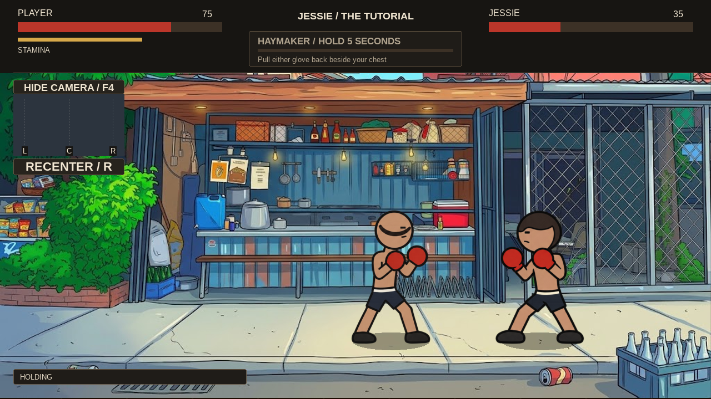
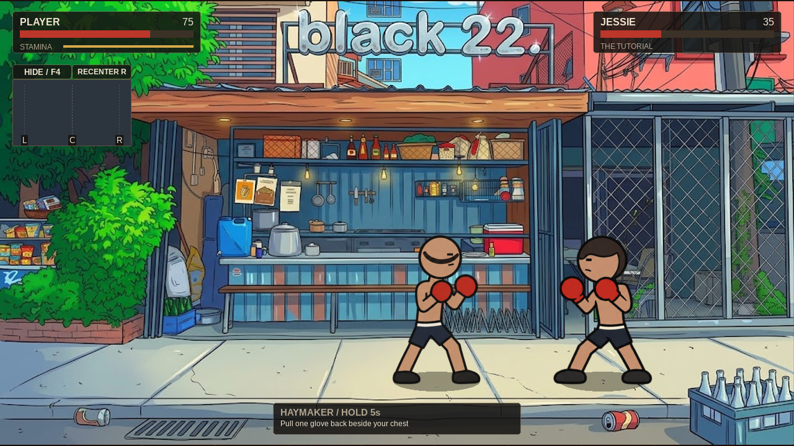
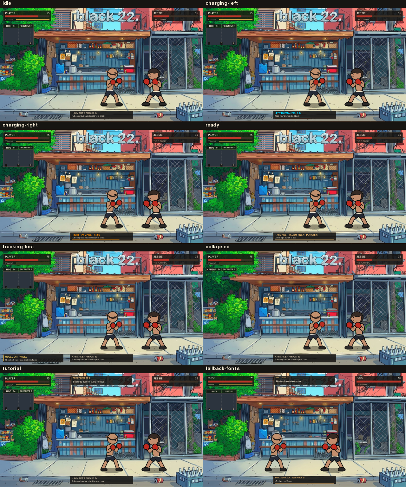
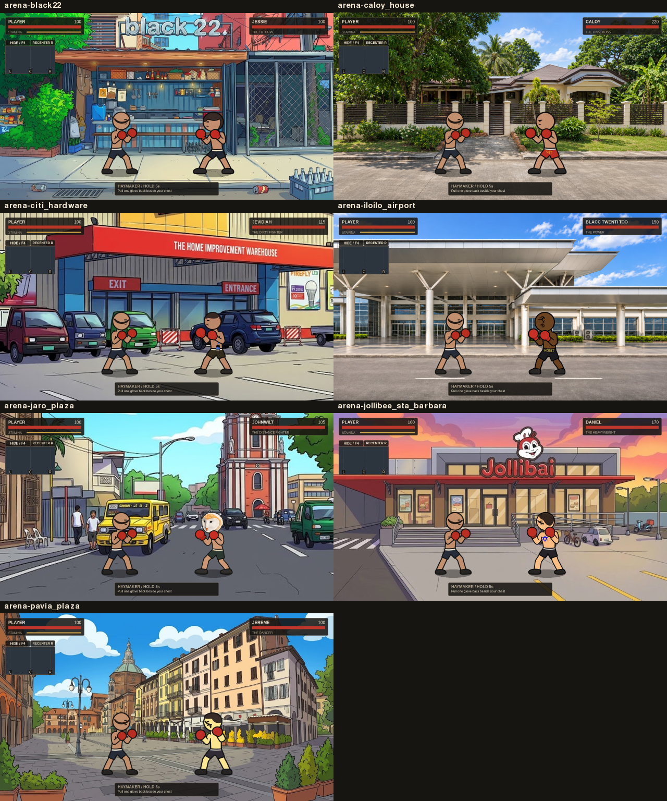

# Arena-first fight HUD

Implemented on `drive-assets-update` against `4466114`, November 5, 2026.
The full-width opaque 132-pixel header has been replaced with two translucent
304×68 health cards. Names, numeric health, health bars, stamina, and opponent
titles remain visible. The opponent's name is no longer repeated in the center.
The existing full-screen maps, 240-pixel fighters, feet at y=620, movement,
collision, camera orientation, and combat rules are unchanged.

Haymaker feedback sits in a 400×52 bottom-center card below the fighters. Idle
pose instructions remain visible; charging uses the anatomical arm color,
remaining seconds, corrective hint, and progress bar. Gameplay-owned readiness
remains gold until the next accepted punch. Keyboard instructions use J/K.

Camera show/hide and recenter share a 192×24 toolbar above the 192×108 inset.
Both controls remain visible and clickable when collapsed; F4/R are preserved.
Invisible camera controls no longer intercept keyboard-mode clicks. Preview
projection, guides, and fresh-sample caching are retained.

The tutorial presents one unfinished objective and a completion count instead
of a 360×200 checklist. Routine HOLDING/MOVING/keyboard status is omitted from
the fight HUD. Actual tracking loss or missing hips still produces a clear
bottom-left warning, separate from haymaker feedback. During an opponent's
countdown, the message now says OPPONENT DOWN rather than asking the player to
raise their hands.

## Before and after

Matched fixture: same map, positions, health, and idle frame. Camera imagery is
synthetic and contains no person. These are rendered game screens, not mockups.









## Visibility and performance

The capture tool draws only overlays onto a solid canvas and counts untouched
pixels. Fighters are excluded from this measurement. Even translucent panels
count as covered; the metric does not claim those areas are completely opaque.

| State | Arena pixels untouched before | After |
|---|---:|---:|
| Health/stamina/charge HUD only | 80.39% | 93.26% |
| HUD plus visible camera | 76.75% | 90.52% |
| HUD, camera, tutorial | 68.94% | 88.11% |
| HUD, camera, tracking warning | 76.75% | 88.38% |

Backplates and text are cached. Sequential runs of the existing software
presentation benchmark gave:

| Measurement | Before | After |
|---|---:|---:|
| Warm fight draw, median | 0.37 ms | 0.38 ms |
| Warm fight draw, p95 | 0.83 ms | 0.74 ms |
| Fresh synthetic preview draw, median | 1.47 ms | 1.39 ms |
| Largest measured screen construction + draw | 4.51 ms | 3.66 ms |

Warm rendering is essentially unchanged within run-to-run noise. These are
headless CPU construction/draw timings, excluding window presentation, vsync,
camera inference, and device latency. They are not measurements of live FPS or
end-to-end input latency. Raw results are in [fight-hud-metrics.json](fight-hud-metrics.json).

## Verification

**149 tests pass**, including nine new HUD checks for visibility budgets,
health/stamina values, both charge-arm colors and progress, persistent readiness
after an empty sample, contextual keyboard instructions, actionable warnings,
bundled/fallback text containment for every opponent, expanded/collapsed camera
click targets, and progressive tutorial display. Existing movement, collision,
mirror/cache, charge, knockout/get-up, navigation, and delayed-camera regressions
continue to pass.

Reviewed all seven arenas, idle/left-charge/right-charge/ready/tracking-loss/
collapsed/tutorial states, and bundled/fallback fonts. Captures at 960×540,
1280×720, 1920×1080, and the reported 758×905 window size preserve the logical
canvas without clipped controls. Portrait windows retain existing letterboxing;
a landscape window provides larger text. No live webcam was opened for these UI
checks, and no tracking-accuracy claim is made.

Reproduce with the project's activated environment:

```sh
python -m unittest discover -s tests -q
python tools/preview_fight_hud.py --output /tmp/fight-hud-review
python tools/benchmark_presentation.py --output /tmp/fight-hud-benchmark
```

`preview_fight_hud.py --repo /path/to/baseline --output /tmp/fight-hud-before`
uses the same fixture against another checkout. Saves and settings are temporary;
no real calibration, personal recordings, credentials, environments, or local
assistant folders are included in the delivery.
