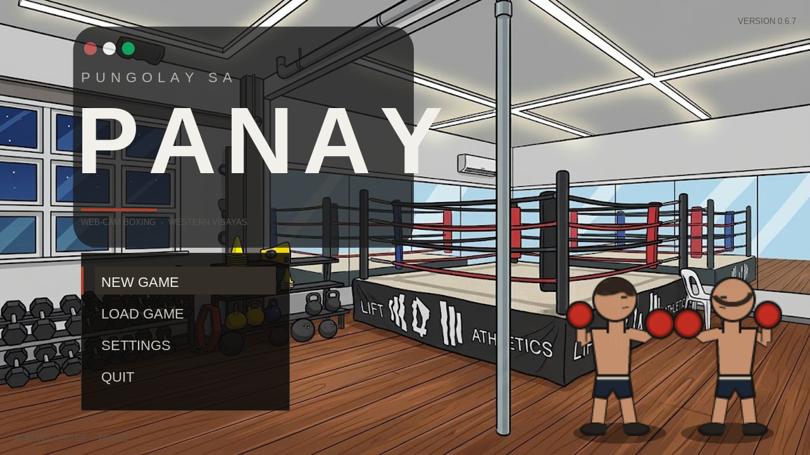
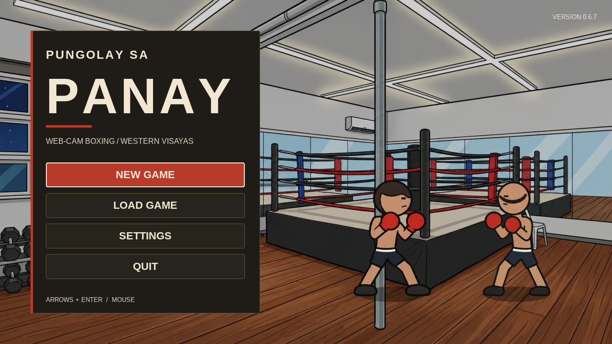
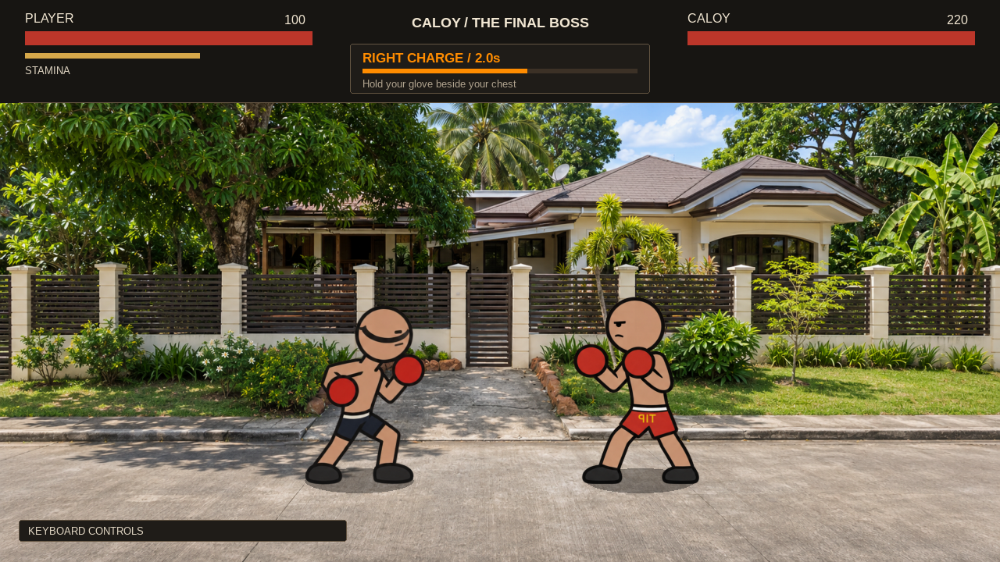
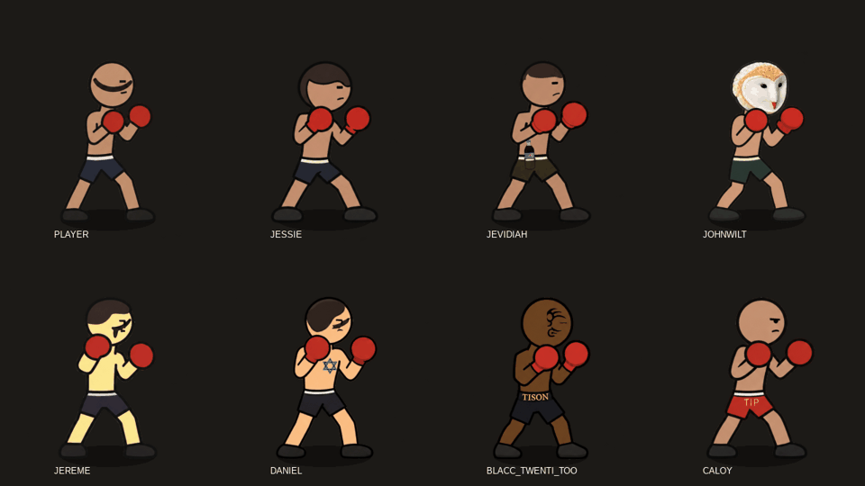

# Stable movement, recovery animation, and poster interfaces

Validated on November 5, 2026 (Asia/Manila), against `drive-assets-update`
baseline `68d74caa752403e354a4d4d8727459cd84257152`.
Upstream `main` was `c49d23add9cc5c26f65f0a66359cd47613903579`, an ancestor
of this branch. The seven map PNGs, original identity PNGs, 240-pixel body
height, foreground ground line at y=620, and saved-progress format are preserved.

## Results and limits

- 121 automated tests pass, expanded from 82. Coverage includes movement intent,
  stationary jitter, outliers, hip confidence, reacquisition/recentering, collision
  separation, attack rejection/readiness, observed-time charge interruptions,
  paused diagnostic isolation, recovery invulnerability, terminal KO holding,
  animation transparency/grounding/mirroring, title bounds, navigation, settings,
  duplicate/stale samples, and deliberately slow camera operations.
- Synthetic stationary jitter at 30 fresh samples/sec produces **zero drift and
  zero walking samples over ten seconds**. A deliberate 4%-width step enters
  moving in **133.33 ms** after stable acquisition. These are synthetic results.
- All eight fighters have idle, fall, and get-up clips in menus/gameplay.
  **23 generated transparent sheets contain 84 new drawn frames.** The planned
  Daniel idle sheet was repeatedly rejected by built-in imagegen without a
  specific explanation. His four logical idle entries reuse the final generated
  get-up guard artwork with subtle foot-anchored runtime breathing. Thus the
  system has 88 new logical frames, 232 total logical animation frames, with one
  documented artwork fallback rather than 24 newly generated fighter sheets.
- No live webcam device was accessible. Live motion accuracy, camera framing,
  end-to-end latency, and displayed FPS still require hardware acceptance.

## Movement and combat behavior

The camera uses confidently visible hips for lateral intent only. Distance
changes cannot move or scale the boxer. A three-sample median, 1.8%-width
entry dead zone, 80 ms sustained entry, 150 ms low-velocity stop, and 150 ms
stable reacquisition suppress small corrections. Outliers/unreliable samples
freeze movement. Reacquisition rebases to the current world position. Movement
speed and acceleration are bounded; R recenters without changing calibration.

Ordinary approach movement stops at body separation plus eight pixels; it does
not shove a stationary opponent into a walking animation. Active hitboxes follow
collision correction. Walking uses the movement left after collision resolution,
with distinct entry/exit thresholds. Knockback remains a combat effect.

One bent arm pulled back at the chest can charge while the other hand is near
guard. Charge has 100 ms entry, five observed seconds of hold, 300 ms tracking-loss
and 150 ms confident-release grace. Brief unobserved intervals pause progress.
The player owns readiness: the next accepted punch from either arm consumes one
2x charge; cooldown/stun/recovery rejection does not spend it. The HUD updates
during hit-stop, and shows arm color, progress, remaining time, corrective hints,
readiness, and activation. Paused setup/debug uses a separate detector so practice
cannot charge the paused fight; resume rebases observation clocks.

Falls last 0.5 seconds and hold the grounded frame through the count. Get-up has
an explicit 0.52-second protected state. Terminal KO cannot return to the standing
fallback. Missing downed artwork uses the procedural lying pose. Hits retain a
compatible prior pose and briefly tint it.

## Recording replay

The supplied screen recording was replayed using its **left camera inset**,
ROI `60,252,496,280`, at 30 sampled frames/sec. Its video stream supplied 975
samples over 32.5 seconds (the container/audio is approximately 32.6 seconds).
There were 935 detected poses, but **zero hip pairs reached the 0.65 confidence
threshold**; median hip confidence was 0.348. The upper-body inset is too small
and cropped, and contains baked tracking lines.

| Isolated locomotion metric | Baseline | Updated |
|---|---:|---:|
| Total character path, pixels | 2477.26 | 0 |
| Character position range, pixels | 305.30 | 0 |
| Idle/walk transitions | 45 | 0 |
| Walking samples | 314 | 0 |

The updated controller refused unreliable movement and froze. **This replay
cannot validate deliberate lateral tracking accuracy or claim that all baseline
movement was unintended.** It excludes AI, knockback, and collision resolution,
and uses inferred initial torso calibration rather than the recording's original
saved calibration. Position stability is validated separately by synthetic tests.

Replay inference was 31.88 ms median / 41.69 ms p95 on this run. Inference timing
is separate from rendering and from live capture-to-display latency.
[Raw aggregate metrics](stable-replay-metrics.json) contain no personal frames or
landmarks. The recording and calibration files are not committed.

## Interface and performance

The clean gym contains no baked panels, window controls, or interface lettering.
The main title and four actions fit one measured panel with bundled and fallback
fonts; fighters use independent idle phases on the right. Settings, setup,
practice, Debug, Pause, load, level select, victory, defeat, and the match header
use consistent cream/charcoal/red/gold live treatments. Distance controls are
hidden while old saved values remain compatible. The small camera preview has a
visible collapse control and saved F4 preference.

Software construction plus first draw, 30 repetitions per screen:

| Screen | Baseline median / max, ms | Updated median / max, ms |
|---|---:|---:|
| Main menu | 0.81 / 5.79 | 0.84 / 4.58 |
| Settings | 0.47 / 3.12 | 0.33 / 4.10 |
| Pause | 0.63 / 15.59 | 0.44 / 3.07 |
| Debug | 0.34 / 9.32 | 0.26 / 0.92 |
| Setup | 0.28 / 8.09 | 0.37 / 2.06 |

All measured responses were below 100 ms. Deliberately delayed camera startup
(over one second) also leaves drawing, Escape, and settings navigation responsive
in automated tests. Audio/settings updates preserve active camera connections.

- Warm match drawing: **0.38 ms median / 0.67 ms p95 / 1.07 ms max**.
- Prewarm request: **0.32 ms**. During asynchronous decoding: drawing max
  **7.63 ms**, Settings construction/draw max **1.06 ms**, all requested frames
  completed. Main-thread uploads use a 2 ms work budget; one surface upload may
  finish beyond the budget boundary before work stops for that frame.
- Duplicate camera-preview draw: **0.49 ms median**; a fresh synthetic frame:
  **1.38 ms median**. These preview timings exclude pose inference/skeleton work
  because the synthetic frame has no valid pose; tests separately verify that
  Debug/practice overlays rebuild only on changed sample/options.
- Active-pair cache: **48.46 MiB**. Exhaustive roster/map preview run sampled
  **101.92 MiB**, below the **128 MiB** animation budget. This covers resident
  surfaces, queued RGBA data, and the single decoded source atlas; it is not a
  measurement of total process memory.

These headless SDL software measurements exclude display flip/vsync, real camera
I/O, and end-to-end input latency. They fit within the 16.7 ms drawing allowance
for 60 FPS, but **do not certify 60 FPS on live hardware**. Values are sampled
benchmarks, not universal upper bounds. Raw [before](stable-ui-before.json),
[after](stable-ui-after.json), [roster/cache](stable-roster-cache-metrics.json),
and [synthetic](stable-synthetic-metrics.json) metrics are included.

## Visual review

Reviewed both font paths across all menus, all eight fighters on all seven maps,
and window sizes 960x540, 1280x720, 1600x1000, and the reported narrow 758x905 size.
The logical canvas remains letterboxed; title/buttons fit their measured bounds.
Automated frame checks verify alpha, unclipped cell bounds, neutral scale,
mirroring, feet within two pixels of the ground, and identical terminal KO frames.
Generated idle/fall/get-up contact sheets and an animated preview were inspected.

Before:



After:







Final art is under `assets/sprites/animations/` and the clean background is
`assets/menu/menu_background_clean.png`. The prompt set and fallback inventory are
in `assets/sprites/animations/generation-stable.json`. Built-in imagegen was used;
no API-key or CLI image-generation fallback was used.

## Reproduction and hardware acceptance

```bash
python -B -m unittest discover -s tests -q
python -B tools/benchmark_presentation.py --output /tmp/pungolay-ui
python -B tools/benchmark_movement.py /path/to/recording.mp4 \
  --model assets/models/yolo11n-pose.onnx --roi 60,252,496,280 \
  --output /tmp/pungolay-replay.json
python main.py
```

On a webcam, keep both hips and wrists inside the frame, calibrate the facing
direction, compare raw/filtered arms, and practice left/right punches, charging,
and guard. Confirm a still stance stays idle, deliberate steps begin promptly,
lost tracking freezes movement, R rebases without jumping, both arms can spend
readiness, and Pause → Settings → Debug → Escape → Escape stays in the paused
fight. Check the F4 preview preference, fall/count/get-up, and final fallen KO.
Measure displayed FPS and camera/inference latency separately on that device.
